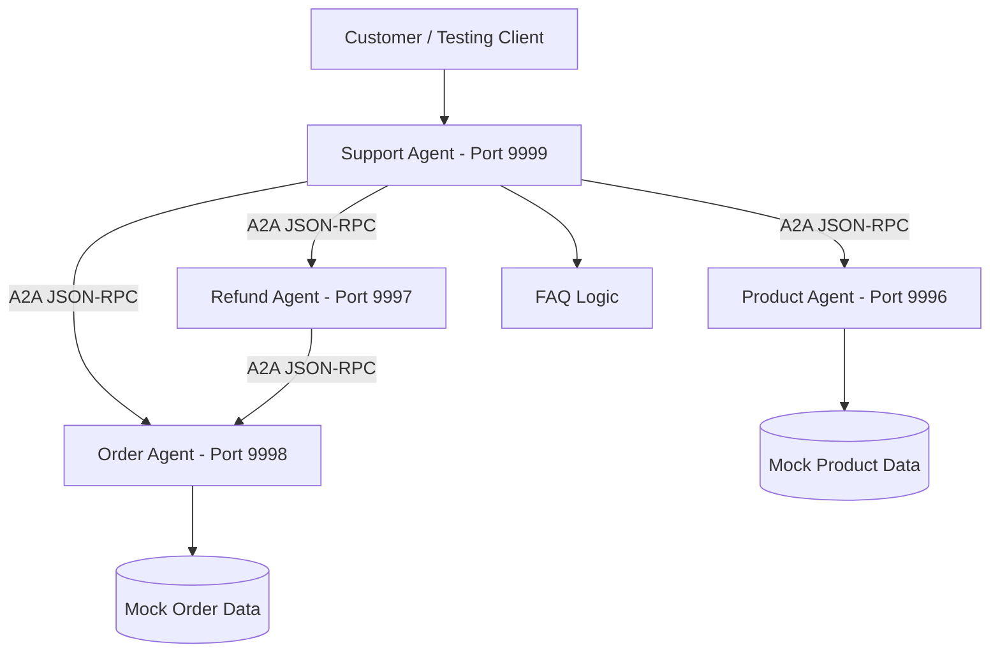
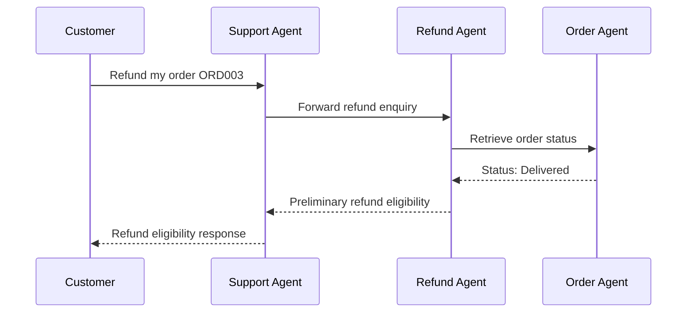

# Zero-Cost A2A Customer Support System

A multi-agent customer support system built using the Agent-to-Agent (A2A) Protocol, designed to demonstrate practical AI engineering and agent collaboration without relying on paid AI APIs.


## Project Overview

Traditional customer support chatbots often rely on a single system to handle multiple responsibilities.

This project explores a modular multi-agent architecture where specialized agents communicate and collaborate using the A2A Protocol.

The long-term goal is to integrate local LLMs, persistent data storage, intelligent routing, and a user-friendly interface while maintaining zero paid AI API costs.

## Current Development Status

The project is currently in Phase 4: Supervisor Agent and Architecture.

Phase 4.1: Shared A2A Client and Agent Registry is completed.

- Four operational agents
- A2A JSON-RPC communication
- Centralized Agent Registry
- Shared A2A Client
- Shared Agent Card discovery
- Centralized configuration
- Unified agent startup commands
- Rule-based intent routing
- Multi-agent collaboration
- Basic service failure handling
- 45 automated tests passed
- No paid AI API dependency

Supervisor Agent, local LLM integration, database integration, and frontend development are planned for upcoming phases.

## System Architecture



## Agent Responsibilities

| Agent | Port | Responsibility |
|---|---:|---|
| Support Agent | 9999 | Customer support, FAQ and request routing |
| Order Agent | 9998 | Order status and tracking information |
| Refund Agent | 9997 | Refund policy and preliminary eligibility checks |
| Product Agent | 9996 | Product information, pricing, stock and recommendations |
| Supervisor Agent | Planned | Centralized orchestration and intelligent routing |

## Key Features

### Agent-to-Agent Communication

Agents communicate using the A2A Protocol with JSON-RPC transport.

### Agent Discovery

Agents retrieve connection information from Agent Cards instead of directly hardcoding the communication endpoint.

The current implementation uses predefined Agent Card URLs.

### Shared A2A Architecture

Common communication components are centralized in the shared package.

| Module | Responsibility |
|---|---|
| config.py | Centralized ports, URLs and timeout settings |
| agent_registry.py | Centralized agent registration and URL lookup |
| agent_discovery.py | Agent Card discovery |
| a2a_client.py | Reusable A2A communication client |

The Support Agent and Refund Agent reuse these shared components to reduce duplicated code and improve maintainability.

### Multi-Agent Collaboration

The Refund Agent communicates with the Order Agent to retrieve order status before determining preliminary refund eligibility.

### Service Failure Handling

The system provides fallback responses when specialist agent services are unavailable.

### Zero Paid API Cost

The current system operates locally without requiring paid AI APIs.

Future local AI integration will use Ollama and Qwen models.

## Technology Stack

### Currently Implemented

| Technology | Purpose |
|---|---|
| Python | Main programming language |
| A2A Python SDK | Agent communication |
| JSON-RPC | Communication transport |
| Starlette | Agent server framework |
| Uvicorn | ASGI server |
| HTTPX | HTTP client |
| Pytest | Automated testing |
| Git and GitHub | Version control |

### Planned Technologies

| Technology | Purpose |
|---|---|
| Ollama | Local LLM runtime |
| Qwen 3 | Intelligent intent classification |
| SQLite | Persistent data storage |
| Streamlit | User interface |
| Docker | Containerized deployment |
| GitHub Actions | Continuous integration |

## Getting Started

### Prerequisites

- Python 3.14
- Git
- Windows PowerShell or an equivalent terminal

### 1. Clone the Repository

```powershell
git clone https://github.com/laihan1/zero-cost-a2a-customer-support.git
cd zero-cost-a2a-customer-support
```

### 2. Create a Virtual Environment

```powershell
python -m venv .venv
.\.venv\Scripts\Activate.ps1
```

### 3. Install Dependencies

```powershell
python -m pip install -r requirements.txt
```

### 4. Start the Agent Services

Open four separate terminals in the project root and activate the virtual environment in each terminal.

Terminal 1 — Support Agent

```powershell
python agents/support_agent/main.py
```

Terminal 2 — Order Agent

```powershell
python agents/order_agent/main.py
```

Terminal 3 — Refund Agent

```powershell
python agents/refund_agent/main.py
```

Terminal 4 — Product Agent

```powershell
python agents/product_agent/main.py
```

Keep all four agent services running.

All agents are started as Python modules from the project root.

No manual PYTHONPATH configuration is required.

## Agent Card Endpoints

| Agent | Endpoint |
|---|---|
| Support | http://127.0.0.1:9999/.well-known/agent-card.json |
| Order | http://127.0.0.1:9998/.well-known/agent-card.json |
| Refund | http://127.0.0.1:9997/.well-known/agent-card.json |
| Product | http://127.0.0.1:9996/.well-known/agent-card.json |

## Example Customer Enquiries

| Customer Message | Responsible Agent |
|---|---|
| What are your opening hours? | Support Agent |
| Where is my order ORD001? | Order Agent |
| Can I refund my order ORD003? | Refund Agent |
| How much is the laptop? | Product Agent |
| Is the keyboard available? | Product Agent |
| Recommend a product | Product Agent |

## Example Multi-Agent Collaboration

Customer request:

```text
Can I refund my order ORD003?
```

Agent execution flow:



Example response:

```text
Order ID: ORD003
Order Status: Delivered
Your order may be eligible for a refund, subject to the 7-day refund policy.
```

The current implementation does not execute actual refund transactions or verify delivery dates.

## Automated Testing

With all four agent services running, open another terminal, activate the virtual environment, and execute:

```powershell
python -m pytest tests/ -v
```

### Latest Verified Test Results

| Test Category | Passed | Total |
|---|---:|---:|
| Support Logic | 4 | 4 |
| Support and Order Integration | 6 | 6 |
| Refund Agent | 5 | 5 |
| Refund Integration | 5 | 5 |
| Product Agent | 6 | 6 |
| Product Integration | 6 | 6 |
| Agent Registry | 5 | 5 |
| Shared A2A Client | 5 | 5 |
| Agent Discovery | 3 | 3 |
| Total | 45 | 45 |

Test pass rate: 100% for the current test suite.

These results verify the implemented test scenarios and do not represent complete code coverage or production readiness.

## Current Limitations

- Intent routing relies on keyword matching.
- No local LLM is currently integrated.
- Order and product information uses mock data.
- Agent Card discovery uses predefined URLs.
- Refund eligibility does not verify delivery dates.
- Actual refund transactions are not supported.
- Agent services require manual startup.
- Persistent conversation memory is not implemented.
- Authentication and authorization are not implemented.
- Full A2A task lifecycle and cancellation are not implemented.
- Automated tests do not cover all failure scenarios.

## Development Roadmap

| Phase | Milestone | Status |
|---|---|---|
| 1 | A2A Foundation | Completed |
| 2 | Order Agent and Communication | Completed |
| 3 | Multi-Agent Collaboration | Completed |
| 4 | Supervisor Agent and Architecture | In Progress |
| 5 | Local LLM Integration | Planned |
| 6 | Database and Frontend | Planned |
| 7 | Deployment and Portfolio Release | Planned |

See [ROADMAP.md](ROADMAP.md) for the detailed development plan.

See [CHANGELOG.md](CHANGELOG.md) for version history.

## Cost Considerations

The project currently requires no paid AI API services.

Future development prioritizes open-source tools, local inference, and free-tier hosting where feasible.

Zero paid API cost does not include hardware, electricity, or potential hosting costs.

## Project Purpose

This project is developed as an AI engineering portfolio project to demonstrate:

- Multi-agent system design
- Agent-to-agent communication
- Modular software architecture
- Agent discovery and orchestration
- Automated testing
- System reliability
- Local AI integration
- Cost-conscious AI engineering

## Project Status

Actively under development. New functionality is implemented, tested, documented, and pushed to GitHub at major development milestones.