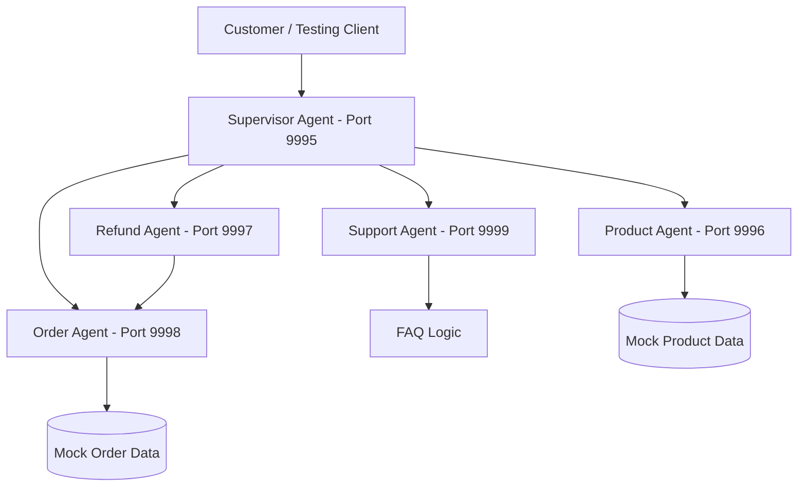
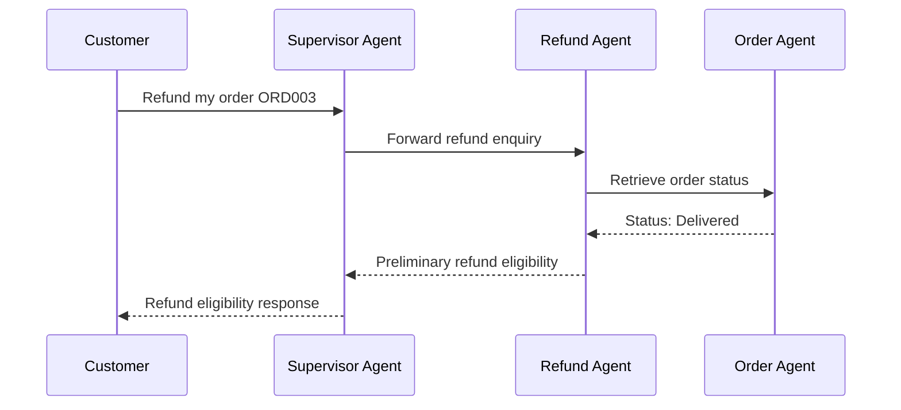

# Zero-Cost A2A Customer Support System

A multi-agent customer support system built using the Agent-to-Agent (A2A) Protocol, designed to demonstrate practical AI engineering and agent collaboration without relying on paid AI APIs.


## Project Overview

Traditional customer support chatbots often rely on a single system to handle multiple responsibilities.

This project explores a modular multi-agent architecture where specialized agents communicate and collaborate using the A2A Protocol.

The Supervisor routes requests using either deterministic keywords or the local LLM intent classifier. Persistent storage and a user interface are planned, with zero paid AI API costs.

## Current Development Status

Phases 1–4 are complete. Phase 4 was published via Git tag `v0.4.0` at commit `cf17927`.

- Five operational agents
- A2A JSON-RPC communication
- Centralized Agent Registry
- Shared A2A Client
- Shared Agent Card discovery
- Centralized configuration
- Unified agent startup commands
- Centralized orchestration through Supervisor Agent
- Configurable Supervisor intent resolution
- Multi-agent collaboration
- Native A2A Text and Data Parts
- Centralized error handling and response validation
- Configurable console logging
- 334 automated tests passed
- No paid AI API dependency

Phase 5.4.3 Supervisor LLM integration was completed, committed, and pushed as `0fb8484`. Phase 5.4.4 adds deterministic fallback and a classification deadline.

### Phase 5.1 Local LLM Environment

Ollama 0.40.18 served `qwen3:4b` (2.5 GB download) at `http://localhost:11434/api/chat`. The test machine used Python 3.14.7, an Intel Core i5-12450H, 16 GB RAM, and an NVIDIA GeForce RTX 4050 Laptop GPU with 6 GB VRAM. GPU offloading was 100%, observed GPU memory usage was 2844 MiB, and warm generation ran at approximately 51 tokens/sec.

JSON mode produced incorrect or unsupported intents. JSON Schema with enum constraints passed all four standalone smoke cases.

| Intent | Result | Latency |
|---|---|---:|
| `order` | PASS | 0.61 s |
| `refund` | PASS | 4.59 s |
| `product` | PASS | 0.32 s |
| `support` | PASS | 0.32 s |

The four-case smoke test scored 4/4 with a mean latency of 1.46 s. Full benchmarking is pending, including follow-up on the initial cold start (134.14 s) and refund latency (4.59 s).

### Phase 5.2 Shared Local LLM Client

`shared.llm_client.chat(messages, *, response_format=None, require_complete=False)` sends a non-streaming request to the local Ollama `/api/chat` endpoint using the existing HTTPX dependency. It forwards an optional JSON Schema as `format` and returns non-empty `message.content` as a string. The client validates the response envelope. Callers can opt into normal-completion checks with `require_complete=True`. The default preserves existing caller behavior.

`shared.config.load_llm_config(environ=None)` reads the environment on demand and returns an immutable `LLMConfig`. Pass a mapping to load settings independently of the process environment.

| Variable | Default | Purpose |
|---|---|---|
| `LLM_ENABLED` | `false` | Enable local inference for the classifier and Supervisor |
| `LLM_BASE_URL` | `http://localhost:11434` | Loopback HTTP origin |
| `LLM_MODEL` | `qwen3:4b` | Local model name |
| `LLM_TIMEOUT` | `15.0` | HTTPX operation timeout and Supervisor classification budget, in seconds |
| `LLM_TEMPERATURE` | `0` | Sampling temperature |
| `LLM_NUM_CTX` | `2048` | Context window in tokens |
| `LLM_NUM_PREDICT` | `64` | Maximum generated tokens |
| `LLM_THINK` | `false` | Enable Ollama thinking mode |
| `LLM_KEEP_ALIVE` | `10m` | Model residency after a request |

With Ollama running and `qwen3:4b` available locally, enable the client in the current PowerShell session.

```powershell
$env:LLM_ENABLED = "true"
```

Run this example in Python from the project root in the same shell.

```python
import asyncio

from shared.llm_client import chat

messages = [{"role": "user", "content": "Say hello in one sentence."}]
print(asyncio.run(chat(messages)))
```

The client disables environment proxies and redirects and makes a single request per call. It preserves native `httpx.HTTPStatusError` and uses the independent `LLMError` hierarchy for disabled, transport, timeout, and invalid-response failures. Application logs contain request outcomes and HTTP status codes only. The HTTPX timeout applies to network operations. A strict end-to-end deadline remains outside the client.

### Phase 5.3 Standalone Structured Intent Classifier

`await classify_intent(user_message)` from `shared.intent_classifier` returns one of `order`, `refund`, `product`, or `support`. It uses the shared customer message validator before inference. The classifier separates system instructions from customer text and forwards a JSON Schema that requires exactly one `intent` field. It independently rejects malformed JSON, duplicate keys, extra fields, and values outside the supported enum.

The classifier requires `done is True` and `done_reason == "stop"`. Incomplete or invalid responses raise `LLMResponseError`. Existing client exceptions propagate to the caller.

To try it, run local Ollama with the configured model available, set `$env:LLM_ENABLED = "true"` in PowerShell, then run the following Python example from the project root in the same shell.

```python
import asyncio

from shared.intent_classifier import classify_intent

async def main():
    intent = await classify_intent("Where is my order ORD001?")
    print(intent)

asyncio.run(main())
```

### Customer Message Validation

The standalone classifier and Supervisor accept non-blank strings of at most 400 Unicode code points. They reject isolated surrogate code points and preserve valid messages exactly, including whitespace and supplementary Unicode characters. The character limit is conservative and does not guarantee a model token budget.

Invalid input reaching the Supervisor executor produces native A2A Text and Data Parts with `agent="supervisor"`, `success=false`, `data={}`, and `error_code="INVALID_INPUT"`. The message is “Please provide a valid customer message of up to 400 characters.” Validation runs before routing or specialist communication, regardless of the LLM setting. The A2A SDK can reject malformed requests before execution.

## System Architecture

- Supervisor routing: Customer request → validation → keyword or local LLM intent resolution → specialist agent → structured response.
- Standalone classification: Customer message → intent classifier → shared LLM client → local Ollama → strict validation → intent string.



## Agent Responsibilities

| Agent | Port | Responsibility |
|---|---:|---|
| Support Agent | 9999 | Handles FAQ and general customer support questions |
| Order Agent | 9998 | Order status and tracking information |
| Refund Agent | 9997 | Refund policy and preliminary eligibility checks |
| Product Agent | 9996 | Product information, pricing, stock and recommendations |
| Supervisor Agent | 9995 | Centralized orchestration with configurable intent routing |

## Key Features

### Supervisor Agent

The Supervisor validates customer input and resolves an intent before calling one specialist through A2A.

- With `LLM_ENABLED=false` or unset under valid configuration, the Supervisor uses keyword routing. This mode requires no Ollama connection or health check.
- With `LLM_ENABLED=true`, the Supervisor awaits the local classifier once and uses its validated intent. The specialist receives the original message and remains responsible for the customer response.

The loader validates all LLM settings in both modes. During an enabled classification attempt, `LLMDisabledError`, `LLMUnavailableError`, `LLMTimeoutError`, `LLMResponseError`, `httpx.HTTPStatusError`, and confirmed Supervisor deadline expiration each trigger one keyword fallback. Invalid configuration, unrelated `TimeoutError`, unexpected errors, and external cancellation propagate before any specialist call. `AGENT_UNAVAILABLE` still applies to specialist communication failures.

The two time limits run concurrently and use the same `LLM_TIMEOUT` value, which defaults to 15 seconds. HTTPX limits network operations. The Supervisor deadline covers the entire awaited classification, including response parsing and validation. Keyword fallback and specialist communication run after the timeout context exits. The deadline is cooperative. Scheduling, blocking work, and cancellation cleanup can affect elapsed time, and local cancellation does not guarantee that Ollama stops server-side inference immediately.

### Agent-to-Agent Communication

Agents communicate using the A2A Protocol with JSON-RPC transport.

### Agent Discovery

Agents retrieve connection information from Agent Cards instead of directly hardcoding the communication endpoint.

The current implementation uses predefined Agent Card URLs.

### Shared A2A Architecture

Common communication components are centralized in the shared package.

| Module | Responsibility |
|---|---|
| config.py | Centralized ports, URLs and timeout settings |
| agent_registry.py | Centralized agent registration and URL lookup |
| agent_discovery.py | Agent Card discovery |
| a2a_client.py | Reusable A2A communication client and response validation |
| response_schema.py | Standardized AgentResponse schema |
| response_message.py | Native A2A response message builder |
| exceptions.py | Shared communication exceptions |
| logging_config.py | Centralized console logging |

The Supervisor Agent and Refund Agent reuse these shared components to reduce duplicated code and improve maintainability.

### Structured Agent Responses

- Standardized response schema shared by all agents.
- Native A2A Text Part and Data Part support.
- Consistent agent, success, message, data and error_code fields.
- Structured order status communication between Refund and Order Agents.
- Supervisor forwards structured responses while preserving the original agent identity.
- Backward compatibility with existing text responses.

### Multi-Agent Collaboration

The Refund Agent communicates with the Order Agent to retrieve order status before determining preliminary refund eligibility.

### Service Failure Handling

The shared communication layer handles connection failures, timeouts, invalid JSON, malformed Agent Cards and response parts, and JSON-RPC errors. HTTP status errors retain their native HTTPX exception type. Structured responses are validated before use.

The Supervisor and Refund Agents preserve their existing fallback messages and error codes (`AGENT_UNAVAILABLE` and `ORDER_AGENT_UNAVAILABLE`). A specialist service failure does not prevent unrelated agents from handling requests.

### Logging

All five agent entry points configure Python console logging. The default level is INFO. To enable DEBUG, set the environment variable before starting an agent:

```powershell
$env:LOG_LEVEL = "DEBUG"
```

Set it back to `INFO` for normal operation. Application logs record routing, discovery, communication outcomes and error types without intentionally logging customer messages, order IDs or full response payloads. External library logs are not covered by this guarantee.

### Zero Paid API Cost

The current system operates locally without requiring paid AI APIs.

The standalone local LLM client uses Ollama and Qwen without a paid AI API.

## Technology Stack

### Currently Implemented

| Technology | Purpose |
|---|---|
| Python | Main programming language |
| A2A Python SDK | Agent communication |
| JSON-RPC | Communication transport |
| Starlette | Agent server framework |
| Uvicorn | ASGI server |
| HTTPX | HTTP client |
| Pytest | Automated testing |
| Git and GitHub | Version control |
| Ollama and Qwen 3 | Standalone local inference through the shared LLM client |

### Planned Technologies

| Technology | Purpose |
|---|---|
| SQLite | Persistent data storage |
| Streamlit | User interface |
| Docker | Containerized deployment |
| GitHub Actions | Continuous integration |

## Getting Started

### Prerequisites

- Python 3.14
- Git
- Windows PowerShell or an equivalent terminal

### 1. Clone the Repository

```powershell
git clone https://github.com/laihan1/zero-cost-a2a-customer-support.git
cd zero-cost-a2a-customer-support
```

### 2. Create a Virtual Environment

```powershell
python -m venv .venv
.\.venv\Scripts\Activate.ps1
```

### 3. Install Dependencies

```powershell
python -m pip install -r requirements.txt
```

### 4. Start the Agent Services

Open five separate terminals in the project root and activate the virtual environment in each terminal.

Terminal 1 — Support Agent

```powershell
python -m agents.support_agent.main
```

Terminal 2 — Order Agent

```powershell
python -m agents.order_agent.main
```

Terminal 3 — Refund Agent

```powershell
python -m agents.refund_agent.main
```

Terminal 4 — Product Agent

```powershell
python -m agents.product_agent.main
```
Terminal 5 — Supervisor Agent

```powershell
python -m agents.supervisor_agent.main
```

Keep all five agent services running.

All agents are started as Python modules from the project root.

No manual PYTHONPATH configuration is required.

## Agent Card Endpoints

| Agent | Endpoint |
|---|---|
| Support | http://127.0.0.1:9999/.well-known/agent-card.json |
| Order | http://127.0.0.1:9998/.well-known/agent-card.json |
| Refund | http://127.0.0.1:9997/.well-known/agent-card.json |
| Product | http://127.0.0.1:9996/.well-known/agent-card.json |
| Supervisor | http://127.0.0.1:9995/.well-known/agent-card.json |

## Example Customer Enquiries

| Customer Message | Responsible Agent |
|---|---|
| What are your opening hours? | Support Agent |
| Where is my order ORD001? | Order Agent |
| Can I refund my order ORD003? | Refund Agent |
| How much is the laptop? | Product Agent |
| Is the keyboard available? | Product Agent |
| Recommend a product | Product Agent |

## Example Multi-Agent Collaboration

Customer request:

```text
Can I refund my order ORD003?
```

Agent execution flow:



Example response:

```text
Order ID: ORD003
Order Status: Delivered
Your order may be eligible for a refund, subject to the 7-day refund policy.
```

The current implementation does not execute actual refund transactions or verify delivery dates.

## Automated Testing

With all five agent services running, open another terminal, activate the virtual environment, and execute:

```powershell
python -m pytest tests/ -v
```

For the Phase 5.3 targeted checks, run the following command. For the full regression, start all five agents and run the suite with `LLM_ENABLED=false` in the agent and test processes.

```powershell
python -m pytest tests/test_intent_classifier.py tests/test_llm_client.py tests/test_llm_config.py tests/test_supervisor_logic.py -q -p no:cacheprovider
```

### Latest Verified Test Results

| Test Category | Passed | Total |
|---|---:|---:|
| Support Logic | 4 | 4 |
| Support and Order Integration | 6 | 6 |
| Refund Agent | 5 | 5 |
| Refund Integration | 5 | 5 |
| Product Agent | 6 | 6 |
| Product Integration | 6 | 6 |
| Agent Registry | 6 | 6 |
| Shared A2A Client | 25 | 25 |
| Agent Discovery | 14 | 14 |
| Supervisor Logic | 11 | 11 |
| Supervisor Integration | 5 | 5 |
| Structured Response Unit Tests | 9 | 9 |
| Structured Integration Tests | 6 | 6 |
| Executor Failure Tests | 12 | 12 |
| Logging Configuration | 6 | 6 |
| Phase 4 regression baseline | 126 | 126 |
| Phase 5.2 LLM configuration and client tests | 63 | 63 |
| Full Phase 5.2 regression | 189 | 189 |
| Phase 5.3 targeted verification (74 existing and 60 new cases) | 134 | 134 |
| Full Phase 5.3 regression | 249 | 249 |
| Full Phase 5.4.2 regression | 302 | 302 |
| Full Phase 5.4.3 regression | 321 | 321 |
| Full Phase 5.4.4 regression | 334 | 334 |

Phase 5.2 passed 63 LLM unit tests in 0.27 s and 189 full regression tests in 3.66 s. Phase 5.3 passed 134 targeted tests in 0.51 s and 249 full regression tests in 3.75 s, with zero failures, errors, or skips in the full run. All five agent services returned their expected Agent Cards over HTTP 200 with `LLM_ENABLED=false`. Ollama remained reachable. Operation with Ollama completely unavailable remains unverified.

Phase 5.4.2 passed 139 classifier, client, configuration, and keyword-router tests in 0.64 s, plus 60 validation and executor tests in 0.85 s. The full regression passed 302 tests in 4.31 s, with all five agents and `LLM_ENABLED=false`.

Phase 5.4.3 passed 66 Supervisor and executor tests in 0.89 s, 152 validation and shared LLM tests in 0.62 s, and 11 focused A2A integration tests in 1.48 s. The full regression passed 321 tests in 4.40 s with all five agents and `LLM_ENABLED=false`. Enabled-mode routing used mocked inference.

Phase 5.4.4 passed 79 Supervisor and executor tests in 1.11 s, 152 shared validation and LLM tests in 0.69 s, 11 A2A integration tests in 1.48 s, and 334 full regression tests in 4.49 s. Deadline and cancellation tests used controlled async classifiers. All five agent services ran with `LLM_ENABLED=false` during the integration and full regression runs.

The Phase 5.2 live client smoke test passed 2/2 requests with `qwen3:4b`. Both returned the expected `order` intent. The first request took 5.86 s and had an unconfirmed cold-start state. The warm request took 0.55 s. The test used a temporary 180-second HTTPX timeout. These two observations provide smoke coverage only, with accuracy and performance benchmarking pending.

Phase 5.3 live smoke testing used Ollama 0.40.18 and an already-loaded `qwen3:4b` model. All seven cases passed with the default 64-token allowance and a temporary 180-second HTTPX timeout. No larger token allowance was needed.

| Case | Expected | Actual | Latency (s) |
|---|---|---|---:|
| S01 | order | order | 1.057 |
| S02 | order | order | 0.586 |
| S03 | refund | refund | 0.499 |
| S04 | refund | refund | 0.492 |
| S05 | product | product | 0.500 |
| S06 | support | support | 0.481 |
| S07 | support | support | 0.485 |

Mean latency was 0.586 s, median 0.499 s, minimum 0.481 s, and maximum 1.057 s. These seven cases provide smoke coverage. General accuracy, prompt-injection resistance, classifier cold-start performance, and reliability with the default 15-second timeout remain unverified.

Phase 4 manual checks covered Order Agent shutdown, Supervisor and Refund fallback responses, continued Product Agent operation, console logging, and recovery after restarting Order Agent.

These results verify the implemented test scenarios and do not represent complete code coverage or production readiness.

## Current Limitations

- Live enabled-mode routing, actual Ollama outages, server-side cancellation, and cold-start fallback remain unverified. Comprehensive accuracy and latency benchmarking is pending.
- The cooperative Supervisor deadline applies only to classification. The complete Supervisor request has no new end-to-end deadline.
- Order and product information uses mock data.
- Agent Card discovery uses predefined URLs.
- Refund eligibility does not verify delivery dates.
- Actual refund transactions are not supported.
- Agent services require manual startup.
- Persistent conversation memory is not implemented.
- Authentication and authorization are not implemented.
- Full A2A task lifecycle and cancellation are not implemented.
- Automated tests do not cover all failure scenarios.

## Development Roadmap

| Phase | Milestone | Status |
|---|---|---|
| 1 | A2A Foundation | Completed |
| 2 | Order Agent and Communication | Completed |
| 3 | Multi-Agent Collaboration | Completed |
| 4 | Supervisor Agent and Architecture | Completed and published via Git tag `v0.4.0` |
| 5 | Local LLM Integration | Phase 5.4.4 fallback and classification deadline regression-verified. Live Supervisor verification pending. |
| 6 | Database and Frontend | Planned |
| 7 | Deployment and Portfolio Release | Planned |

See [ROADMAP.md](ROADMAP.md) for the detailed development plan.

See [CHANGELOG.md](CHANGELOG.md) for version history.

## Cost Considerations

The project currently requires no paid AI API services.

Future development prioritizes open-source tools, local inference, and free-tier hosting where feasible.

Zero paid API cost does not include hardware, electricity, or potential hosting costs.

## Project Purpose

This project is developed as an AI engineering portfolio project to demonstrate:

- Multi-agent system design
- Agent-to-agent communication
- Modular software architecture
- Agent discovery and orchestration
- Automated testing
- System reliability
- Local AI integration
- Cost-conscious AI engineering

## Project Status

Actively under development. New functionality is implemented, tested, documented, and pushed to GitHub at major development milestones.
